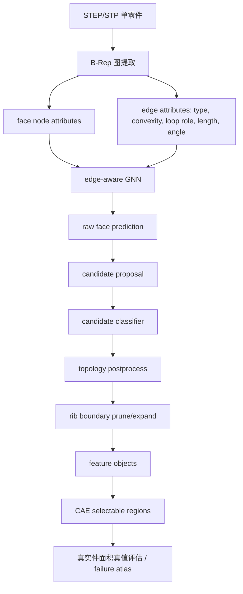

# 面向 CAE STEP 特征识别的相关文献、先进 baseline 与大模型融合路线

最后更新：2026-07-01
工作目录：`W:/python/FEA/dataset_generator`
用途：用于组会/导师汇报，可直接拆成 4-5 页 PPT。

## 1. 核心结论

当前文献趋势可以概括为一句话：

> 对 STEP/B-Rep 这类精确 CAD 几何，先进方法并不是让大模型直接“看懂 STEP 并选面”，而是先把 B-Rep 转换成结构化的面、边、环、邻接图，再用图网络、拓扑规则、pointer/entity selection 或候选对象分类完成几何实体选择；大模型更适合做语义推理、任务规划、候选重排序、数据标注和人机交互层。

因此，从计算机与 CAD/CAE 几何学习角度看：

- 不建议用通用 LLM 直接替代当前的 B-Rep/GNN 识别网络。
- 建议把大模型作为“CAE 语义推理 + 候选对象决策 + 智能体编排”模块接入。
- 底层仍应保留方向不敏感的 B-Rep 图、边属性、拓扑合法性规则和候选实例识别。
- 论文创新点可以从“面向 CAE 的 B-Rep 图表示 + 拓扑约束 + 候选对象级修复 + 大模型辅助 CAE 语义选择”展开。

## 2. 当前最相关文献与可参考 baseline

| 方向                  | 代表文献                                                                                                    | 核心思想                                                                                                                                                           | 对本项目的启发                                                                                                                               |
| --------------------- | ----------------------------------------------------------------------------------------------------------- | ------------------------------------------------------------------------------------------------------------------------------------------------------------------ | -------------------------------------------------------------------------------------------------------------------------------------------- |
| B-Rep 直接学习        | [BRepNet, CVPR 2021 Oral](https://arxiv.org/abs/2104.00706)                                                  | 直接在 B-Rep 上做 topological message passing，围绕 oriented coedge 构造卷积核；发布 Fusion 360 Gallery segmentation dataset。                                     | 是 B-Rep 分割最经典 baseline。说明 CAD 几何识别不应先转网格/点云，而应保留面、边、coedge、拓扑邻接。                                         |
| B-Rep 几何 + 图拓扑   | [UV-Net, CVPR 2021](https://arxiv.org/abs/2006.10211)                                                        | 用曲面 UV 参数域采样表达连续几何，同时用 adjacency graph 表达离散拓扑。                                                                                            | 可作为高级 baseline：面几何不只用面积/曲率标量，也可以引入 UV-grid / edge-grid 局部几何编码。                                                |
| 旋转不变 B-Rep 学习   | [FoV-Net, CVPR 2026](https://arxiv.org/abs/2602.24084)                                                       | 指出现有 B-Rep 方法依赖绝对坐标和法向时会对旋转非常敏感；用 Local Reference Frame + Field-of-View ray casting 获得旋转不变局部几何和全局上下文。                   | 与我们此前遇到的“旋转后识别失败”高度相关。后续可作为 v6.0 级别改进：增强旋转不变 face descriptor 和局部可见域上下文。                      |
| 加工特征实例识别      | AAGNet, Wu et al. 2024，用户本地参考文献                                                                    | 基于 attributed adjacency graph 的多任务加工特征识别。                                                                                                             | 本项目最初参考的路线。优点是端到端学习 face label / instance grouping；不足是目标是加工特征，不是 CAE 语义区域。                             |
| 样本高效 panoptic AFR | [FeatureFox, 2026](https://arxiv.org/abs/2604.26770)                                                         | 先用 enriched edge attributes 训练二分类边界分类器，再在剪枝后的面邻接图中取连通分量作为实例，最后对实例子图分类；用 Panoptic Quality 同时评估实例分割和语义识别。 | 这是目前最值得参考的先进 baseline。它与我们当前“候选对象 + 拓扑修复”的方向一致，但更强调 edge boundary classifier 和 panoptic evaluation。 |
| B-Rep 生成与拓扑表示  | [SolidGen, TMLR 2023](https://arxiv.org/abs/2203.13944)                                                      | Transformer + pointer network 直接生成 B-Rep 顶点、边、面；提出 Indexed B-Rep 表示。                                                                               | 说明 pointer/entity reference 是 CAD 几何学习的重要方向。对我们可启发为：输出不只是类别，而是可引用的面/边集合。                             |
| 大模型 CAD 生成       | [CAD-MLLM, 2024](https://arxiv.org/abs/2411.04954)                                                           | 用多模态输入生成 CAD command sequence；构建 Omni-CAD 约 45 万模型，并提出拓扑质量评价指标。                                                                        | 证明大模型在 CAD 生成方向活跃，但其任务是生成 command sequence，不是 STEP 面级识别。它也指出 CAD 表示、拓扑质量和数据规模是难点。            |
| LLM 参数化 CAD        | [CAD-Llama, 2025](https://arxiv.org/abs/2505.04481)                                                          | 将 CAD command sequence 转换成 code-like SPCC，再对 LLM 做预训练和指令微调。                                                                                       | 这篇文献明确说明：预训练 LLM 不天然具备 CAD 参数序列和 3D 结构知识，需要专门表示和专门训练。                                                 |
| LLM + B-Rep pointer   | [Pointer-CAD, 2026](https://arxiv.org/abs/2603.04337)                                                        | 在 LLM 生成 CAD 命令时加入 face/edge pointer，让模型显式选择已有 B-Rep 实体；其架构仍包含 B-Rep graph encoder。                                                    | 这是导师要求“大模型”的最强参考之一。它支持我们的判断：大模型不是直接替代几何图网络，而是通过 pointer 显式引用 B-Rep 面/边。                |
| B-Rep 多任务大模型    | [BrepCoder, 2026](https://arxiv.org/abs/2602.22284)                                                          | 将 CAD 建模序列转为 Python-like code 并与 B-Rep 对齐，进行 reverse engineering 预训练，再扩展到 completion、error correction、CAD-QA 等任务。                      | 可作为未来“大模型 CAD agent”的参考，但它仍依赖结构化 B-Rep/code 表示，不是裸 LLM 读取 STEP。                                               |
| Text-to-CAD 代码生成  | [Text-to-CadQuery, 2025](https://arxiv.org/abs/2505.06507)；[CADmium, 2025](https://arxiv.org/abs/2507.09792) | 将自然语言转成 CadQuery 或 JSON CAD sequence，利用 code LLM 的代码生成能力。                                                                                       | 对本项目的启发主要在“智能体/工具调用/代码生成”层，不直接解决真实 STEP 中面/边选择问题。                                                    |

## 3. 这些文献对本项目的判断

### 3.1 现阶段不宜让大模型完全替代 GNN

理由如下：

1. **STEP/B-Rep 是图结构和精确几何，不是自然语言。**B-Rep 中一个特征是否成立，依赖面类型、边类型、环角色、凹凸性、曲率、面积、邻接关系和实例连通性。纯文本化后容易丢失置换不变性、局部拓扑和精确度量关系。
2. **最新 LLM-CAD 文献也没有绕开 B-Rep 编码。**Pointer-CAD 虽然使用 LLM，但仍先构建 face-adjacency graph，并用 GNN 聚合 B-Rep 面/边信息，再让 LLM 输出 token 和 pointer。CAD-Llama 也强调 LLM 需要专门 CAD 表示和训练才能具备空间知识。
3. **我们当前任务是“识别真实 STEP 中的特征面/面集”，不是“生成 CAD”。**CAD-MLLM、Text-to-CadQuery、CAD-Llama、CADmium 主要是生成任务。生成任务可以输出 command sequence；而我们的任务需要在已有 STEP 中稳定、可追溯、可解释地选中具体面 ID。
4. **LLM 直接输出面 ID 存在严重工程风险。**面 ID 数量不固定，顺序不稳定，长模型容易超 token；没有几何内核约束时，LLM 可能输出不存在的面、遗漏相邻面、合并不该合并的实例。
5. **GNN/拓扑规则具有正确归纳偏置。**
   B-Rep 面邻接图天然适合图网络；边界、连通分量、候选实例、拓扑合法性规则天然适合特征识别。对于“面积为 20 的曲面，通过长度为 10 的凹边，与面积为 100 的平面连接”这类信息，图表示比自然语言更直接。

### 3.2 但大模型应该进入系统

大模型可以进入以下四个位置：

1. **CAE 需求解析层**输入：“固定所有盲孔”“在 U 形槽内壁施加压力”“选取薄壁肋板区域”。输出：结构化查询，例如：

   ```json
   {
     "intent": "apply_boundary_condition",
     "target_macro": "blind_hole_round",
     "target_subregion": ["cylindrical_wall", "bottom_face"],
     "operation": "fixed_support"
   }
   ```
2. **候选对象推理层**GNN 和规则先提出候选实例，大模型读取候选对象的结构化摘要：

   - 候选面集合；
   - 面类型、面积、曲率、环角色；
   - 相邻边类型、凹凸性、长度；
   - 拓扑规则证据；
   - 与典型特征模板的匹配分数。

   大模型输出：保留、删除、合并、拆分、重命名和解释。
3. **hard case 挖掘和数据增强层**大模型根据失败报告总结错误类型，自动生成“需要补强的数据配置建议”，例如：

   - 小尺度 countersink；
   - 多面 rib；
   - pocket 中含 rib；
   - outer cylinder 被误识别为 through hole；
   - slot_u 与 obround_hole 的混淆。
4. **智能体编排层**大模型不直接识别几何，而是调用工具：

   - `extract_graph(step)`；
   - `propose_candidates(graph)`；
   - `classify_candidates(candidates)`；
   - `apply_topology_rules(candidates)`；
   - `match_cae_requirement(features, query)`；
   - `export_abaqus_selection(features)`。

## 4. 当前项目实现方案梳理

当前项目已经形成如下流程：



关键工作已经包括：

- 从早期单一方块毛坯扩展到板、梁、圆柱、多种非交叉特征和 hard case 数据。
- 将目标范围限定为结构静力 CAE 前处理中可显式查询的几何区域。
- 建立目标类别：孔、沉孔、埋头孔、长圆孔、槽、腔、凸台、肋/腹板、圆角、倒角。
- 加入真实 STEP 可计算的 face descriptor 和 edge_attr。
- 处理方向敏感问题，逐步削弱绝对坐标依赖。
- 引入 topology rules 修复不合法孔、外圆柱/内孔壁混淆、transition 误检等。
- 引入 candidate-level classifier 处理对象级混淆。
- 引入 rib boundary classifier / proposer 处理 rib/stock、rib/pocket、rib/web 边界。
- 在用户手工建模的 `test_part_s`、`test_part_s1`、`test_part_s2`、`test_part_s3` 上进行泛化验证。

当前核心代码模块：

| 模块                                                                | 作用                             |
| ------------------------------------------------------------------- | -------------------------------- |
| `main.py`                                                         | 数据集生成入口。                 |
| `core/AAGExtractor.py`                                            | STEP 到 B-Rep 属性图的核心提取。 |
| `utils/training_export.py`                                        | 将图 JSON 转换为训练样本。       |
| `train_gnn_baseline.py`                                           | 训练 edge-aware GNN。            |
| `run_gnn_inference.py`                                            | 对真实 STEP 进行推理。           |
| `utils/topology_rules.py` / `utils/topology_postprocess.py`     | 拓扑合法性规则和后处理。         |
| `build_candidate_classifier_dataset.py`                           | 构建候选对象分类器训练集。       |
| `train_candidate_topology_classifier.py`                          | 训练候选级分类器。               |
| `build_rib_boundary_classifier_dataset.py`                        | 构建 rib 边界分类训练集。        |
| `prediction_to_feature_objects.py`                                | 将面级预测转换为特征对象输出。   |
| `generate_failure_atlas.py` / `generate_v5_7_failure_report.py` | 失败图谱和误差分析。             |

## 5. 推荐的完整研究路线

### 5.1 第一阶段：巩固几何拓扑 baseline

目标：证明 B-Rep 图表示是有效的。

需要完成：

- 继续完善 face/edge 属性，重点保留旋转不变或相对量：
  - 面类型、面积、曲率、包围盒尺度比、UV span；
  - 边类型、长度、凹凸性、二面角；
  - 环角色：inner loop / outer loop；
  - face 与 edge 的局部邻接模板；
  - 候选对象的总面积、主尺度、细长比、边界开口数。
- 建立规则 baseline：
  - 只用拓扑规则识别孔、槽、凸台、transition；
  - 作为可解释传统方法对照。
- 建立学习 baseline：
  - 当前 edge-aware GNN；
  - AAGNet-style 多任务；
  - FeatureFox-style edge boundary classifier + connected components + instance classifier。

推荐优先做 FeatureFox-style baseline，因为它与我们当前对象级修复思路最接近，也最容易转化为论文对比实验。

### 5.2 第二阶段：构建 CAE 语义目标数据集

目标：突出本论文不是普通加工特征识别，而是面向 CAE 前处理。

需要完成：

- 生成训练集：
  - clean single/multi feature；
  - non-intersecting multi-feature；
  - focused hard cases；
  - transition hard cases；
  - rib/web/pocket hard cases；
  - countersink/counterbore hard cases。
- 建立真实件测试集：
  - 用户手工建模的简化真实件；
  - 记录面积真值；
  - 对关键失败样本补充 face-level 真值，而不是只用面积总和。
- 评价指标：
  - face-level macro-F1；
  - class-wise precision/recall；
  - object-level recall / precision；
  - instance-level IoU；
  - panoptic quality, PQ；
  - rotation consistency；
  - CAE region selection accuracy。

### 5.3 第三阶段：加入大模型模块，但不替代底层 B-Rep 识别

推荐的大模型模块名：

> CAE-LLM Reasoning Agent for B-Rep Feature Selection

输入不是原始 STEP，而是结构化候选对象摘要：

```json
{
  "candidate_id": "part3_cand_12",
  "faces": [17, 18, 19],
  "macro_pred": "slot_u",
  "gnn_confidence": 0.82,
  "candidate_classifier": {
    "slot_u": 0.61,
    "obround_hole": 0.29,
    "fillet": 0.05
  },
  "topology_evidence": {
    "has_parallel_side_faces": true,
    "has_concave_connection_to_base": true,
    "has_closed_inner_loop": false,
    "aspect_ratio": 7.6
  },
  "cae_context": "pressure on U-slot inner wall"
}
```

输出：

```json
{
  "decision": "keep",
  "macro": "slot_u",
  "action": "select_inner_faces",
  "confidence": 0.87,
  "reason": "Candidate has long swept side faces, concave base connections, and no closed inner loop; therefore it is closer to slot_u than obround_hole."
}
```

这样做的好处：

- 满足“加入大模型高级模块”的汇报要求；
- 不破坏 B-Rep 几何识别的严谨性；
- 输出可解释；
- 可与当前 candidate classifier 做消融对比；
- 可以用服务器的 A40 做 LoRA 微调或批量推理；
- 失败样本可以自动转化为新的训练数据和规则建议。

### 5.4 第四阶段：论文实验设计

建议实验分组：

| 实验组                     | 方法                                                      | 目的                                              |
| -------------------------- | --------------------------------------------------------- | ------------------------------------------------- |
| Rule-only                  | 传统拓扑规则                                              | 证明规则方法在真实件上可解释但覆盖不足。          |
| Face GNN                   | 只做面级分类                                              | 证明单面分类无法稳定处理实例边界。                |
| Edge-aware GNN             | 当前主模型                                                | 证明 edge_attr 有效。                             |
| GNN + topology postprocess | 当前拓扑修复                                              | 证明显式拓扑约束减少不合法孔/槽/凸台。            |
| GNN + candidate classifier | 当前候选对象级分类                                        | 证明对象级特征优于单面预测。                      |
| FeatureFox-style baseline  | edge boundary + connected component + instance classifier | 作为先进 baseline。                               |
| Ours + LLM reranker        | 大模型候选决策层                                          | 证明 LLM 在 hard-case 和 CAE 语义选择上提供增益。 |

重点不是只追求一个最高 accuracy，而是证明：

- 面向 CAE 的目标类别定义更贴近工程使用；
- B-Rep 图表示能保留真实 STEP 的可选面区域；
- 拓扑约束能修复神经网络的几何常识错误；
- 大模型适合做语义推理和候选决策，而不是裸替代几何识别器。

## 6. 4-5 页 PPT 汇报建议

### 第 1 页：研究问题与目标

标题：面向结构静力 CAE 前处理的 STEP 特征识别与区域选择

要点：

- CAE 前处理需要稳定选择孔壁、槽内壁、支承面、肋板、圆角/倒角等区域。
- 通用 LLM 可以描述模型，但不能可靠选中 STEP/B-Rep 中的具体面。
- 传统规则可解释，但面对真实零件组合特征时泛化不足。
- 本工作目标：从 STEP 中自动识别 CAE 语义特征对象，并输出可选面集。

图示建议：

```text
STEP -> B-Rep graph -> feature objects -> CAE selectable regions
```

### 第 2 页：相关研究与 baseline

标题：为什么采用 B-Rep 图学习，而不是直接让大模型读 STEP

要点：

- BRepNet / UV-Net：B-Rep 面、边、coedge 和 UV 几何是 CAD 学习主流表示。
- AAGNet：AAG 图适合加工特征识别，但目标不是 CAE 区域选择。
- FeatureFox：最新趋势是 edge boundary classifier + instance classifier，而不是单纯面分类。
- FoV-Net：旋转不变性是 B-Rep 学习的重要问题。
- Pointer-CAD / BrepCoder：大模型 CAD 也需要 B-Rep 编码、结构化表示或 pointer 选择。

结论句：

> 大模型可以增强语义推理，但底层几何拓扑识别仍需要 B-Rep 图表示和显式约束。

### 第 3 页：当前实现路线

标题：当前系统：edge-aware GNN + topology-aware candidate repair

要点：

- 程序化生成 STEP 数据集并保留面级真值。
- 从 STEP 提取 face node attributes 和 edge attributes。
- 训练 edge-aware GNN 进行面级初判。
- 将面预测合并成候选对象。
- 使用候选级分类器和拓扑规则修复：
  - through hole / outer cylinder 混淆；
  - cylinder boss / blind hole 混淆；
  - slot_u / obround hole 混淆；
  - rib / stock / pocket 边界混淆；
  - fillet / slot_o 混淆。
- 在简化真实件上用面积真值和 failure atlas 做泛化验证。

### 第 4 页：大模型融入方案

标题：CAE-LLM Agent：让大模型做语义推理和候选决策

要点：

- 不让 LLM 直接读取 STEP 并输出面 ID。
- 先由 B-Rep 图网络和拓扑规则产生候选对象。
- 将候选对象转成结构化摘要输入 LLM。
- LLM 判断：
  - 候选是否保留；
  - 是否合并/拆分；
  - 应归为哪个 CAE 语义类别；
  - 应选择哪些子区域作为加载/约束/理想化区域。
- LLM 还负责解析仿真需求，例如“固定所有盲孔”“选择 U 槽内壁施加压力”。

图示建议：

```text
User CAE requirement
        |
      LLM parser
        |
B-Rep GNN candidates ----> LLM candidate reasoner
        |                         |
 topology rules ------------------
        |
CAE selectable feature objects
```

### 第 5 页：已完成工作与下一步计划

标题：当前进展与后续计划

已完成：

- 初步建立 CAE 特征体系。
- 完成多版本 STEP 数据集生成器。
- 完成 B-Rep 图提取、edge_attr、loop-role、拓扑规则。
- 完成 edge-aware GNN、candidate classifier、rib boundary classifier。
- 完成多批真实件验证和 failure atlas。

下一步：

1. 补充先进 baseline：FeatureFox-style edge boundary classifier + instance classifier。
2. 引入 FoV-Net 启发的旋转不变局部 descriptor。
3. 建立 LLM candidate reasoner：
   - 输入候选对象结构化摘要；
   - 输出 keep/delete/merge/split/classify；
   - 与非 LLM classifier 做消融对比。
4. 完善真实件 face-level 真值，特别是 rib、slot、pocket、transition。
5. 形成论文实验：
   - synthetic clean；
   - synthetic hard cases；
   - simplified real STEP；
   - ablation study；
   - CAE selectable region case study。

## 7. 推荐给导师的严谨表述

可以这样说：

> 我们调研了 BRepNet、UV-Net、AAGNet、FeatureFox、FoV-Net 以及 Pointer-CAD、BrepCoder、CAD-Llama 等近期工作。结论是：大模型在 CAD 方向主要用于 command sequence/code 生成、自然语言条件建模和 entity pointer 选择，但并没有取代 B-Rep 几何拓扑编码。对于我们这种需要在已有 STEP 中选中具体面的 CAE 前处理任务，直接让 LLM 替代 GNN 不够科学，因为它缺少精确几何、拓扑邻接和置换不变归纳偏置。更合理的路线是：底层采用 B-Rep 图学习和拓扑规则保证几何可靠性，上层引入大模型做仿真需求理解、候选对象推理和智能体编排。这样既能体现大模型模块，也能保持工程可验证性和论文严谨性。

## 8. 最建议马上做的技术工作

短期最值得做三件事：

1. **实现 FeatureFox-style baseline。**训练 edge boundary classifier，预测哪些邻接边属于同一实例内部，哪些是实例边界；再用连通分量得到 feature object；最后做 instance-level 分类。
2. **实现 LLM candidate reasoner 的最小可行版本。**先不用微调，使用结构化 prompt 输入候选对象 JSON，输出分类/合并/删除决策；只在 hard cases 上评估。若有效，再考虑 LoRA 微调。
3. **建立汇报用 ablation table。**至少包含：

   - rule-only；
   - face GNN；
   - edge-aware GNN；
   - + topology postprocess；
   - + candidate classifier；
   - + LLM candidate reasoner。

这条路线既能回应“加入大模型”的要求，也不会把论文建立在不可靠的“LLM 直接识别 STEP 面”的假设上。
