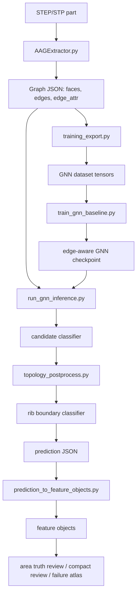

# CAE STEP Feature Recognition Project Handoff

Last updated: 2026-06-29  
Workspace: `W:/python/FEA/dataset_generator`  
Python environment: `W:/python/envs/feagpt/python.exe`  
Main purpose: help a fresh agent understand the complete project, current state, research logic, implemented workflow, remaining work, and expected final outcome.

## 1. One-Sentence Summary

This project studies CAE-oriented feature recognition and selectable-region extraction from single-part STEP/STP models for structural static analysis preprocessing, using B-Rep graph learning plus topology-aware candidate repair to identify faces or face groups such as holes, slots, ribs, bosses, pockets, fillets, and chamfers.

## 2. Research Scope

The first paper is intentionally limited to:

```text
Single-part structural static CAE preprocessing:
geometric feature recognition + selectable region extraction
```

The target is not a general CAD reconstruction system and not a full-feature commercial preprocessing tool. The paper should focus on a practical, verifiable, publishable slice:

- Input: a STEP/STP part model.
- Intermediate representation: B-Rep attributed adjacency graph.
- Output: CAE-relevant feature objects and selectable face regions.
- Downstream use: support region selection for loads, constraints, idealization, and later Abaqus mapping.

Out of current scope:

- Assembly-level reasoning.
- Full natural-language-to-simulation automation.
- Full-feature CAD history reconstruction.
- General manufacturing feature recognition as the only target.
- Full Abaqus model setup as the primary contribution.

## 3. Why This Work Exists

The user is familiar with finite element analysis and wants to combine AI with FEA. In CAE preprocessing, engineers often need to select functional geometric regions:

- fixed support on blind holes or mounting holes;
- pressure on through-hole walls or cavity walls;
- load/support on boss, pad, or end faces;
- idealization candidates such as ribs or thin wall regions;
- local transition regions such as fillets and chamfers.

Generic LLMs can talk about geometry but cannot reliably select B-Rep faces in a STEP model. Traditional rule scripts can identify simple features but become brittle on realistic parts. This project aims to combine:

- generated labeled data,
- invariant B-Rep graph descriptors,
- graph neural network recognition,
- explicit topology rules,
- candidate-level classifiers,
- real/simplified-real STEP validation.

## 4. Final Intended System Behavior

The intended final pipeline is:

```text
STEP/STP model
    -> B-Rep graph extraction
    -> face/node and edge attributes
    -> edge-aware GNN prediction
    -> candidate object proposal
    -> candidate-level topology classifier
    -> topology postprocess / legality repair
    -> feature objects
    -> selectable CAE regions
    -> optional Abaqus mapping
```

Expected final outputs for each model:

- per-face macro feature label;
- per-face semantic subtype label;
- grouped feature objects with face indices;
- object-level area, centroid, bounding box, confidence, and fingerprint;
- selectable regions useful for CAE tasks;
- diagnostic reports comparing predictions with area-based truth.

## 5. Target Feature System

The current first-paper target classes include:

### Hole Features

- `through_hole_round`
- `blind_hole_round`
- `stepped_hole_round`
- `counterbore_hole`
- `countersink_hole`
- `obround_hole`

Important definitions:

- `through_hole_round`: one full cylindrical wall, two circular opening boundaries, no bottom face.
- `blind_hole_round`: cylindrical wall plus bottom face.
- `stepped_hole_round`: coaxial multi-radius hole with bottom, representing a blind stepped hole.
- `counterbore_hole`: large cylindrical wall + shoulder plane + smaller through cylindrical wall; no bottom face.
- `countersink_hole`: conical countersink face + small through cylindrical wall.
- `obround_hole`: racetrack-like hole, usually two side planes plus two cylindrical end faces.

### Slot And Pocket Features

- `slot_rect`
- `slot_u`
- `slot_v`
- `slot_o`
- `pocket_rect`
- `pocket_circular`

Important idea:

- Slot classes should be generated as swept closed profiles along a path on an existing surface where possible.
- `slot_u`, `slot_v`, and `slot_o` have caused repeated real-part confusion and require topology-aware repair.

### Boss And Pad Features

- `cylinder_boss`
- `rectangular_boss`

Important idea:

- A cylinder with outer-loop / outer-cylinder-wall role should not be recognized as a through-hole.
- A through-hole wall must be an inner-loop / inner-hole-wall cylinder.

### Rib / Web / Thin-Wall Features

- `rib`
- `web` is currently treated as a shared thin-wall/rib-like target family in rules.

Important idea:

- Ribs are CAE-relevant because they affect idealization and load paths.
- Area-only truth is not enough for rib boundary decisions; face-level truth is needed for reliable next-step improvement.

### Transition Features

- `fillet`
- `chamfer`

Current decision:

- Fillets and chamfers remain independent target outputs in the first paper.
- But transition over-detection is lower priority unless it changes a CAE operation.

## 6. Major Design Decisions

1. The graph node is a B-Rep face.
2. The graph edge is a face adjacency relation, enhanced with edge attributes.
3. Edge attributes are not the main output; they support topology reasoning.
4. The model should learn and use invariant topology and geometric descriptors, not absolute coordinate orientation.
5. Candidate-level object repair is necessary because face-level GNN predictions can be locally correct but globally inconsistent.
6. Area-based truth is acceptable for quick real-part validation, but insufficient for rib and complex boundary repair.
7. A realistic first paper should combine learning and topology constraints instead of claiming end-to-end AI solves all STEP understanding.

## 7. Project Architecture

### Main Data Flow



### Key Source Directories

- `features/`: procedural feature generators.
- `core/`: B-Rep graph extraction.
- `utils/`: graph export, topology rules, postprocess, validation, reporting helpers.
- `configs/`: dataset and truth configurations.
- `tests/`: regression tests for topology repair, graph handling, candidate classifiers, reports.
- `docs/`: research notes, plans, and prior design documents.
- `output_*`: generated datasets, trained models, validation predictions, and reports.

## 8. Important Scripts And Their Roles

### Dataset Generation

- `main.py`
  - Main procedural dataset generator.
  - Creates STEP files, graphs, labels, and manifests according to YAML configs.

- `build_augmented_dataset.py`
  - Builds augmented training distributions and hard-case mixtures.

- `generate_ablation_dataset.py`
  - Generates ablation datasets for comparing feature sets or graph descriptors.

- `features/*.py`
  - Feature-specific geometry generation.
  - Important files include `through_hole.py`, `blind_hole.py`, `counterbore_hole.py`, `countersink_hole.py`, `stepped_hole.py`, `obround_hole.py`, `slot_rect.py`, `slot_u.py`, `swept_slot.py`, `swept_channel_slot.py`, `rib.py`, `boss_feature.py`, `rect_pocket.py`, `fillet_feature.py`, and `chamfer_feature.py`.

### Graph Extraction And Export

- `core/AAGExtractor.py`
  - Converts STEP B-Rep into attributed adjacency graph.
  - Extracts face attributes, edge attributes, shape descriptors, loop roles, and topology hints.

- `utils/training_export.py`
  - Defines feature schemas and exports graph JSON into training data.

- `step_to_inference_graph.py`
  - Converts external STEP/STP files into inference graph JSON.

- `upgrade_graph_edge_attributes_from_steps.py`
  - Upgrades existing graphs with edge attributes extracted from corresponding STEP files.

### Training And Inference

- `train_gnn_baseline.py`
  - Trains the current GNN models.
  - Despite the name, this now supports edge-aware GNN variants and current feature schemas.

- `run_gnn_inference.py`
  - Runs trained model inference on graph JSON.
  - Supports candidate classifier, topology postprocess, and rib boundary classifier hooks.

- `evaluate_gnn_predictions.py`
  - Evaluates prediction results on labeled/generated datasets.

### Candidate And Topology Repair

- `build_candidate_classifier_dataset.py`
  - Builds object/candidate-level classifier dataset from graph and prediction results.

- `train_candidate_topology_classifier.py`
  - Trains candidate-level classifier, typically random forest/joblib.

- `utils/candidate_topology_features.py`
  - Extracts candidate object features.

- `utils/candidate_classifier_postprocess.py`
  - Applies candidate classifier to prediction components.

- `utils/topology_rules.py`
  - Defines legal topology checks for target features.

- `utils/topology_postprocess.py`
  - Central rule-based repair module.
  - Very important and large.
  - Contains candidate proposal, topology legality checks, invalid component demotion, semantic subtype repair, through-hole/cylinder role repair, slot repair, rib repair, transition repair.

- `build_rib_boundary_classifier_dataset.py`
  - Builds rib boundary classifier dataset.

- `build_rib_boundary_hardcase_dataset.py`
  - Builds rib-focused hard-case dataset.

- `utils/rib_boundary_classifier_postprocess.py`
  - Applies rib boundary prune/expand decisions.
  - Since v5.7, logs accepted and skipped candidate decisions.

### Feature Object And CAE Mapping

- `prediction_to_feature_objects.py`
  - Groups face-level predictions into feature objects.
  - Computes feature object fingerprints and selectable regions.

- `utils/selectable_regions.py`
  - Builds CAE-selectable region descriptors from feature objects.

- `match_simulation_requirements.py`
  - Early utility for matching requirements to recognized features.

- `prediction_to_abaqus_mapping.py`, `abaqus_mapping_to_action_plan.py`, `real_abaqus_minimal_pipeline.py`
  - Early Abaqus mapping experiments.
  - These are not the main contribution yet, but show downstream direction.

### Real-Part Validation And Reports

- `generate_real_step_annotation_template.py`
  - Creates annotation templates for real STEP files.

- `generate_area_truth_review.py`
  - Compares feature objects against area-based truth tables.

- `generate_compact_real_step_review.py`
  - Produces compact human-readable review reports.

- `generate_failure_atlas.py`
  - Creates face-level atlas with graph, predictions, feature objects, and truth.

- `generate_v5_7_failure_report.py`
  - Produces aggregate failure summary, residual error ranking, rib decision summary, and fix recommendations.

- `generate_real_part_sanity_report.py`
  - Checks real-part truth and evaluation sanity.

## 9. Important Current Artifacts

### Best Current GNN Checkpoint

```text
output_generation_v5_5_v51dist_looprole_5400/model_runs/edge_aware_v5_5_expanded_v51_compat_24dim/best.pt
```

This is the currently used stable edge-aware GNN checkpoint.

### Candidate Classifier

```text
output_generation_v5_1_candidate_topology_dataset/model_runs/random_forest_v5_1_candidate_topology_hardw4/model.joblib
```

### Rib Boundary Classifier

```text
output_generation_v5_6_rib_boundary_hardcase_dataset_v3/model_runs/random_forest_rib_boundary_hardcase_v3/model.joblib
```

### Current Real Validation Set

```text
test_part_s3/part1.stp ... part21.stp
configs/test_part_s3_area_truth_part20_mm2.json
```

`part20` originally had unit mismatch in the spreadsheet and has been corrected into mm^2 truth.

### Latest Best Validation Output

```text
output_real_step_s3_v5_8_a_role_repair/
```

Key reports:

```text
output_real_step_s3_v5_8_a_role_repair/reports/v5_8_a_comparison_report.md
output_real_step_s3_v5_8_a_role_repair/reports/v5_8_a_failure_report.md
output_real_step_s3_v5_8_a_role_repair/reports/v5_8_a_failure_atlas.md
output_real_step_s3_v5_8_a_role_repair/reports/compact_review.md
output_real_step_s3_v5_8_a_role_repair/reports/s3_area_truth_validation_v5_8_a.md
```

## 10. Work Completed So Far

### Stage 1: Initial Scope And Feature System

Completed:

- Established first-paper scope as `single-part structural static CAE preprocessing`.
- Rejected overly broad classes such as flange/guide/mounting plate as primary target classes.
- Confirmed formal target classes listed above.
- Decided that features should be CAE-selectable, not merely manufacturing features.

### Stage 2: Dataset Generator Evolution

Completed:

- Started from AAGNet-like generated feature dataset.
- Expanded stock shapes beyond a single box.
- Added plate, beam, block, cylinder, and more realistic combinations.
- Added feature orientation variation.
- Improved slot generation toward swept-profile logic.
- Improved rib generation:
  - original simple rib;
  - corner rib in L-shaped plate context;
  - rib inside rectangular/circular cavities.
- Added geometric validation and reduced destructive feature interference.
- Added hard-case datasets for holes, slots, ribs, countersink/counterbore, and confused classes.

### Stage 3: Graph Extraction

Completed:

- Added B-Rep-computable shape descriptors:
  - face area;
  - center;
  - primitive surface;
  - radius/axis/normal;
  - bbox descriptors;
  - UV span;
  - projected aspect/extent;
  - neighbor statistics.
- Added edge attributes:
  - curve type;
  - length;
  - convexity;
  - dihedral information;
  - loop role hints;
  - cylindrical wall role hints.
- Added role distinctions such as:
  - `inner_loop`;
  - `outer_loop`;
  - `inner_hole_wall`;
  - `outer_cylinder_wall`.

### Stage 4: Model Training

Completed:

- Trained multiple generated-data models from v1 to v5.
- Found generated validation metrics can be high but real-part generalization is weak without better graph roles and topology repair.
- Settled on edge-aware GNN with loop-role features as current best base model.
- Added candidate-level classifier as second-stage object classifier.
- Added rib boundary classifier as specialized boundary prune/expand module.

### Stage 5: Real/Simplified Real Validation

Completed:

- Tested on multiple user-built STEP/STP sets:
  - `test_part`;
  - `test_part_s`;
  - `test_part_s1`;
  - `test_part_s2`;
  - `test_part_s3`.
- Built area-truth JSON files from user-provided spreadsheets.
- Added compact reviews, failure atlas reports, and area-truth matching.
- Identified that large generated-data accuracy does not imply real-part generalization.

### Stage 6: Topology-Aware Repair

Completed:

- Added legality rules for many features.
- Added candidate-level repair for:
  - through holes;
  - blind holes;
  - counterbore/countersink;
  - cylinder boss;
  - rectangular boss;
  - rectangular pocket;
  - slots;
  - rib;
  - fillet/chamfer.
- Added v5.7 candidate decision logging.
- Added v5.8-A through-hole / outer-cylinder / inner-cylinder role repair.

## 11. Latest v5.8-A Result

Validation set: `test_part_s3`  
Truth file: `configs/test_part_s3_area_truth_part20_mm2.json`

| Stage | Truth | Pred | Matched | Recall | Precision | Matched through-hole | Pred through-hole |
|---|---:|---:|---:|---:|---:|---:|---:|
| v5.5 loop-role baseline | 204 | 186 | 108 | 0.5294 | 0.5806 | 32 | 36 |
| v5.6-B rib boundary t=0.75 | 204 | 187 | 118 | 0.5784 | 0.6310 | 32 | 36 |
| v5.6-C rib hard-case t=0.75 | 204 | 194 | 122 | 0.5980 | 0.6289 | 32 | 36 |
| v5.7 best-flow logging baseline | 204 | 194 | 122 | 0.5980 | 0.6289 | 32 | 36 |
| v5.8-A role repair | 204 | 198 | 129 | 0.6324 | 0.6515 | 39 | 43 |

v5.8-A is a clear positive step:

- matched objects improved from `122` to `129`;
- recall improved from `0.5980` to `0.6324`;
- precision improved from `0.6289` to `0.6515`;
- matched through-hole objects improved from `32` to `39`.

## 12. Current Remaining Problems

### High Priority

1. `rib`
   - Missed: `17`
   - False positives: `10`
   - Problem: area-only truth is too coarse for rib boundary repair.
   - Next step: create face-level reviewed truth for selected worst samples.

2. `through_hole_round`
   - Missed: `22`
   - False positives: `4`
   - v5.8-A fixed simple full inner-cylinder role failures.
   - Remaining misses likely include partial/split cylindrical walls and truth-boundary cases.

3. `counterbore_hole`
   - Missed: `4`
   - False positives: `4`
   - Needs targeted rule/data inspection, not broad retraining first.

4. `rectangular_boss`
   - Missed: `4`
   - False positives: `1`
   - Needs candidate-boundary repair and hard-case data.

### Medium Priority

1. `slot_o`
   - False positives: `7`
   - Likely due to confusion with curved transition/large cylindrical surfaces.

2. Rib boundary classifier calibration
   - v5.7/v5.8 reports show skipped low-confidence rib boundary decisions.

### Lower Priority

1. `fillet` and `chamfer`
   - Many residuals, especially false-positive fillets.
   - But transition truth granularity is ambiguous.
   - Defer unless transition selection directly affects a CAE operation.

## 13. Recommended Next Work Plan

### v5.8-B: Rib Boundary With Face-Level Truth

Goal:

- Improve `rib` recognition and boundary membership reliably.

Why:

- Current area truth says a part contains rib objects and total area, but not exact face IDs.
- Rib often absorbs stock, pocket, or transition faces.
- Without face-level truth, classifier tuning is partly blind.

Tasks:

1. Pick worst rib samples from `v5_8_a_failure_report.md`.
2. Create a small face-level review template for those samples.
3. User manually identifies which face IDs belong to rib objects.
4. Build focused rib boundary training data from reviewed truth.
5. Retrain or recalibrate rib boundary classifier.
6. Re-run `test_part_s`, `test_part_s1`, and `test_part_s3`.

### v5.8-C: Counterbore And Rectangular Boss Targeted Repair

Goal:

- Reduce repeated object-boundary failures without disrupting hole classes.

Tasks:

1. Inspect false-positive and missed `counterbore_hole` in failure atlas.
2. Add tests for each repeated failure pattern.
3. Tighten counterbore shoulder/cylinder role constraints.
4. Inspect rectangular boss missing cases.
5. Add candidate completion rules or hard-case data.

### v5.8-D: Remaining Through-Hole Split Cases

Goal:

- Decide whether remaining through-hole misses are true failures or truth-boundary artifacts.

Tasks:

1. Inspect remaining `through_hole_round` misses in `v5_8_a_failure_atlas.md`.
2. Separate full-cylinder misses from partial/split-cylinder cases.
3. Only repair full-cylinder misses with clear inner-hole-wall role.
4. Avoid broad rules that convert partial transition cylinders to through holes.

### v5.9: Consolidated Paper Experiment

Goal:

- Once v5.8 targeted repairs stabilize, freeze a version for paper experiments.

Tasks:

1. Generate a clean training dataset with final target classes.
2. Train final edge-aware GNN.
3. Train final candidate classifier.
4. Train final rib boundary classifier if face-level truth is available.
5. Run:
   - generated validation;
   - ablation experiments;
   - simplified real-part validation;
   - failure analysis.
6. Produce paper-ready tables and figures.

## 14. Proposed Paper Contributions

The paper should not claim generic AI understands all CAD models. Stronger and more defensible contributions are:

1. CAE-oriented feature taxonomy
   - A target feature system designed for structural static preprocessing, not only machining.

2. Invariant B-Rep graph representation
   - Face nodes and edge relations with B-Rep shape descriptors, loop roles, wall roles, convexity, and edge geometry.

3. Hybrid learning-plus-topology pipeline
   - Edge-aware GNN predicts face labels.
   - Candidate-level classifier handles object-level confusion.
   - Topology legality rules repair impossible feature objects.

4. Procedural dataset generator for CAE-relevant features
   - Includes realistic holes, slots, ribs, pockets, bosses, and transitions.
   - Includes hard cases and controlled feature combinations.

5. Real/simplified-real STEP validation protocol
   - Area-based truth review.
   - Failure atlas.
   - Candidate decision logging.
   - Explicit analysis of generated-to-real generalization gap.

6. CAE selectable-region output
   - The final object is not just a class label; it is a selected face group with geometry descriptors useful for boundary/load/idealization workflows.

## 15. Expected Final Effect

The final project should demonstrate that:

1. Given a STEP/STP part, the system can extract a B-Rep graph.
2. The model can identify CAE-relevant features as faces or face groups.
3. The system can output selectable regions for downstream CAE preprocessing.
4. Topology-aware postprocessing improves reliability over raw neural prediction.
5. The approach works not only on generated data but also on simplified user-built real parts.
6. Remaining errors are explainable and categorized rather than hidden.

In a paper, the most convincing final effect would be:

- generated dataset test metrics;
- ablation showing value of edge attributes / loop roles / topology postprocess;
- real-part validation table;
- failure atlas examples;
- case study mapping recognized regions to CAE operations.

## 16. How A New Agent Should Continue

### First Things To Read

1. `PROJECT_AGENT_HANDOFF.md`
2. `CODEX_CONTEXT.md`
3. `output_real_step_s3_v5_8_a_role_repair/reports/v5_8_a_comparison_report.md`
4. `output_real_step_s3_v5_8_a_role_repair/reports/v5_8_a_failure_report.md`
5. `output_real_step_s3_v5_8_a_role_repair/reports/v5_8_a_failure_atlas.md`
6. `utils/topology_postprocess.py`
7. `utils/topology_rules.py`
8. `core/AAGExtractor.py`
9. `train_gnn_baseline.py`
10. `run_gnn_inference.py`

### First Command To Verify Environment

```powershell
W:\python\envs\feagpt\python.exe -m unittest tests.test_topology_postprocess tests.test_topology_postprocess_v5_6 tests.test_topology_postprocess_v5_8 tests.test_candidate_classifier_postprocess tests.test_run_gnn_inference_edge_aware -v
```

Expected current result:

```text
56 tests passed
```

### Current Best Inference Command

```powershell
W:\python\envs\feagpt\python.exe run_gnn_inference.py `
  --checkpoint output_generation_v5_5_v51dist_looprole_5400\model_runs\edge_aware_v5_5_expanded_v51_compat_24dim\best.pt `
  --input-path output_real_step_s3_v5_6_b_rib_boundary\graphs `
  --output-dir output_real_step_s3_v5_8_a_role_repair\predictions `
  --recursive `
  --device auto `
  --candidate-classifier output_generation_v5_1_candidate_topology_dataset\model_runs\random_forest_v5_1_candidate_topology_hardw4\model.joblib `
  --candidate-classifier-min-confidence 0.5 `
  --rib-boundary-classifier output_generation_v5_6_rib_boundary_hardcase_dataset_v3\model_runs\random_forest_rib_boundary_hardcase_v3\model.joblib `
  --rib-boundary-classifier-min-confidence 0.75
```

Then convert predictions:

```powershell
W:\python\envs\feagpt\python.exe prediction_to_feature_objects.py `
  --prediction-path output_real_step_s3_v5_8_a_role_repair\predictions `
  --graph-dir output_real_step_s3_v5_6_b_rib_boundary\graphs `
  --output-dir output_real_step_s3_v5_8_a_role_repair\feature_objects `
  --recursive
```

Then evaluate:

```powershell
W:\python\envs\feagpt\python.exe generate_area_truth_review.py `
  --feature-objects-path output_real_step_s3_v5_8_a_role_repair\feature_objects `
  --truth-json configs\test_part_s3_area_truth_part20_mm2.json `
  --output-json output_real_step_s3_v5_8_a_role_repair\reports\s3_area_truth_validation_v5_8_a.json `
  --output-md output_real_step_s3_v5_8_a_role_repair\reports\s3_area_truth_validation_v5_8_a.md `
  --recursive `
  --relative-area-tolerance 0.02 `
  --absolute-area-tolerance 10.0
```

## 17. Collaboration Pattern With The User

The user should be asked to intervene mainly when engineering/CAE judgment is required:

- Does a feature belong to the paper target taxonomy?
- Does a face group make sense as a CAE selectable region?
- Is a generated STEP geometrically reasonable in UG/NX?
- For rib or complex real-part cases, which exact faces are ground truth?
- Should a transition face be independent or absorbed into a parent feature for a specific CAE use case?

The agent should handle:

- code changes;
- tests;
- dataset generation;
- training/inference;
- report generation;
- failure atlas analysis;
- script explanations.

## 18. Current Caution Points

1. Do not blindly chase generated-data accuracy.
   - Generated validation can be excellent while real-part generalization remains weak.

2. Do not add broad topology rules without regression tests.
   - Many feature classes share similar local topology.

3. Do not use area-only truth for rib boundary training.
   - It is too coarse for deciding exact face membership.

4. Be careful with `fillet`, `slot_o`, and partial cylinder confusion.
   - Curved transition surfaces and swept slot surfaces can look similar.

5. Treat STEP/STP extension difference as practically minor.
   - The more important issue is whether the graph extraction preserves topology roles.

6. Keep changes scoped.
   - Current best direction is targeted repair and better truth, not another broad architecture rewrite.

## 19. Suggested Skills For A New Agent

- `context-journal`: read/update durable project context.
- `superpowers:systematic-debugging`: use before fixing recognition failures.
- `superpowers:test-driven-development`: write regression tests before topology repair.
- `superpowers:verification-before-completion`: verify before claiming fixes.
- `pdf`: use only when returning to literature review.
- `xlsx`: use when reading or correcting feature truth spreadsheets.

## 20. Current Best Next Step

Proceed to:

```text
v5.8-B: rib boundary repair using reviewed face-level truth
```

Recommended concrete first task:

1. Use `v5_8_a_failure_report.md` to identify worst rib samples.
2. Generate a face-level review template for those samples.
3. Ask the user to mark rib face IDs or confirm visually in UG/NX.
4. Build a small reviewed rib boundary dataset.
5. Retrain/calibrate rib boundary classifier.
6. Re-run `test_part_s`, `test_part_s1`, and `test_part_s3`.

This is the most likely next improvement that remains scientifically defensible.
