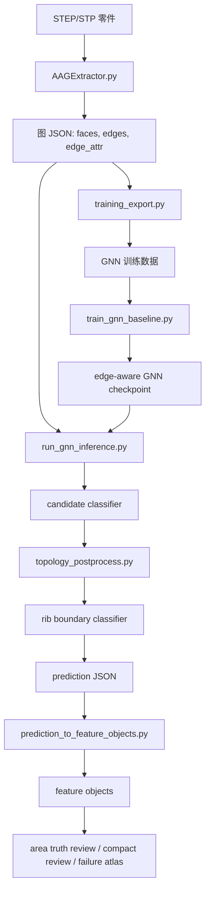

# CAE STEP 特征识别项目交接文档

最后更新：2026-06-29  
工作目录：`W:/python/FEA/dataset_generator`  
Python 环境：`W:/python/envs/feagpt/python.exe`  
文档目的：帮助新的 agent 快速理解本项目的研究目标、技术路线、当前进展、已完成工作、剩余任务、创新点和最终期望效果。

## 1. 一句话概括

本项目研究面向结构静力 CAE 前处理的 STEP/STP 单零件特征识别与可选区域提取，核心方法是将 B-Rep 模型转化为带属性的面邻接图，再结合图神经网络、候选对象分类器和拓扑合法性规则，识别孔、槽、肋、凸台、腔、圆角、倒角等可用于载荷、约束、理想化和网格前处理的几何区域。

## 2. 研究范围

第一篇论文的研究范围明确限定为：

```text
单零件结构静力 CAE 前处理中的几何特征识别与区域选择
```

本项目不是要做通用 CAD 语义理解系统，也不是要做完整商业 CAE 前处理软件。第一篇论文应当集中在一个可实现、可验证、可发表的范围内：

- 输入：STEP/STP 单零件模型。
- 中间表达：B-Rep 属性邻接图。
- 输出：CAE 相关的特征对象和可选择的面区域。
- 下游用途：支持结构静力分析中的载荷区域、约束区域、理想化区域和后续 Abaqus 映射。

当前不作为第一篇论文主目标的内容：

- 装配体级别推理。
- 从自然语言直接生成完整仿真工况。
- 完整 CAD 建模历史重建。
- 只面向加工制造的传统特征识别。
- 完整 Abaqus 模型自动搭建。

## 3. 为什么要做这个工作

用户熟悉有限元分析，希望开展 AI 与 FEA 结合的研究。在 CAE 前处理中，工程师经常需要选择具有工程语义的几何区域，例如：

- 在盲孔、安装孔、通孔内壁等区域施加固定约束；
- 在通孔内壁、腔体内壁、槽内壁施加压力；
- 在凸台、端面、支承面等区域施加载荷或约束；
- 识别肋板、薄壁、腹板等理想化候选区域；
- 识别圆角、倒角等过渡区域，用于局部判断或前处理。

通用大模型可以描述几何，但无法可靠地在 STEP/B-Rep 中显式选中面。传统规则脚本可以识别简单孔、圆柱等特征，但面对真实零件时容易失效。因此本项目采用混合路线：

- 程序化生成带真值标注的数据集；
- 从 STEP 中提取方向不敏感的 B-Rep 图；
- 训练图神经网络进行面级预测；
- 使用拓扑规则修复明显不合法的预测；
- 使用候选对象分类器处理对象级混淆；
- 在用户手工建模的简化真实 STEP 上验证泛化能力。

## 4. 最终希望系统达到的效果

最终希望形成如下完整流程：

```text
STEP/STP 模型
    -> B-Rep 图提取
    -> 面节点属性和边属性
    -> edge-aware GNN 面级预测
    -> 候选对象提议
    -> 候选级拓扑分类器
    -> 拓扑合法性后处理与修复
    -> 特征对象
    -> CAE 可选区域
    -> 可选的 Abaqus 映射
```

对每个模型，期望输出：

- 每个面的宏观特征类别；
- 每个面的语义子类型；
- 按实例分组的特征对象；
- 每个特征对象的面 ID、面积、质心、包围盒、置信度和几何指纹；
- 面向 CAE 的 selectable regions；
- 可供人工检查和论文分析的评估报告。

## 5. 当前目标特征体系

### 5.1 孔类特征

当前第一篇论文的孔类目标包括：

- `through_hole_round`
- `blind_hole_round`
- `stepped_hole_round`
- `counterbore_hole`
- `countersink_hole`
- `obround_hole`

重要定义：

- `through_hole_round`：一个完整圆柱孔壁，具有两个圆形开口边界，没有底面。
- `blind_hole_round`：圆柱孔壁加底部圆面。
- `stepped_hole_round`：同轴多半径盲孔，包含大孔壁、小孔壁、台阶面和底面。
- `counterbore_hole`：大圆柱孔壁、肩部平面、小圆柱通孔壁；小孔贯通，没有底面。
- `countersink_hole`：锥形沉头面加小圆柱通孔壁。
- `obround_hole`：长圆孔，通常由两个平面侧壁和两个圆柱端壁组成。

### 5.2 槽和腔类特征

当前包括：

- `slot_rect`
- `slot_u`
- `slot_v`
- `slot_o`
- `pocket_rect`
- `pocket_circular`

重要思想：

- 槽类特征应尽量按照封闭截面沿表面轨迹扫掠生成，而不是简单布尔切除固定形状。
- `slot_u`、`slot_v`、`slot_o` 在真实件中容易与圆角、长圆孔、局部圆柱面混淆，因此需要拓扑规则和候选级分类器辅助。

### 5.3 凸台类特征

当前包括：

- `cylinder_boss`
- `rectangular_boss`

重要思想：

- 外圆柱面不能因为是完整圆柱面就被误识别为通孔。
- 通孔壁必须具有 `inner_loop` 或 `inner_hole_wall` 角色。
- 外圆柱凸台应具有 `outer_loop` 或 `outer_cylinder_wall` 角色。

### 5.4 肋、腹板、薄壁类特征

当前包括：

- `rib`
- `web`

当前决策：

- 规则层面把 `rib` 和 `web` 视为一组薄壁候选族。
- 论文中可以统一解释为 CAE 中的 rib/web/thin-wall candidate。
- 肋类特征对于结构理想化和载荷路径判断很重要，但对象边界很难只用面积真值确定。

### 5.5 过渡特征

当前包括：

- `fillet`
- `chamfer`

当前决策：

- `fillet` 和 `chamfer` 作为第一篇论文的独立目标输出。
- 但是 transition 类的误检优先级低于孔、肋、凸台、槽等直接影响 CAE 区域选择的特征。
- 只有当 transition 识别错误会影响具体 CAE 操作时，才优先修复。

## 6. 关键设计决策

1. 图节点是 B-Rep 面。
2. 图边是 B-Rep 面之间的邻接关系。
3. 边属性不是最终输出，但用于辅助判断拓扑和特征实例。
4. 模型应学习旋转不敏感的几何与拓扑信息，而不是依赖绝对坐标方向。
5. 单纯面级 GNN 不够，需要对象级候选分类和拓扑合法性后处理。
6. 面积真值适合快速验证真实件，但不适合精确判断 rib 等复杂对象边界。
7. 第一篇论文更适合强调“学习模型 + 显式拓扑约束 + CAE 语义区域”的混合方法，而不是声称端到端 AI 完全理解 CAD。

## 7. 项目整体架构

### 7.1 主流程



### 7.2 关键目录

- `features/`：程序化特征生成器。
- `core/`：B-Rep 图提取。
- `utils/`：图导出、拓扑规则、后处理、验证、报告生成等工具。
- `configs/`：数据集配置和真实件面积真值配置。
- `tests/`：拓扑修复、图处理、候选分类器和报告脚本的回归测试。
- `docs/`：研究笔记、历史计划和设计文档。
- `output_*`：生成数据集、训练模型、推理结果和报告。

## 8. 关键脚本说明

### 8.1 数据集生成

- `main.py`
  - 主数据集生成入口。
  - 根据 YAML 配置生成 STEP、图 JSON、标签和 manifest。

- `build_augmented_dataset.py`
  - 构建增强数据集和 hard-case 数据集。

- `generate_ablation_dataset.py`
  - 生成消融实验数据集。

- `features/*.py`
  - 各类特征生成器。
  - 重要文件包括：
    - `through_hole.py`
    - `blind_hole.py`
    - `counterbore_hole.py`
    - `countersink_hole.py`
    - `stepped_hole.py`
    - `obround_hole.py`
    - `slot_rect.py`
    - `slot_u.py`
    - `swept_slot.py`
    - `swept_channel_slot.py`
    - `rib.py`
    - `boss_feature.py`
    - `rect_pocket.py`
    - `fillet_feature.py`
    - `chamfer_feature.py`

### 8.2 图提取和训练导出

- `core/AAGExtractor.py`
  - 从 STEP 的 B-Rep 中提取属性邻接图。
  - 提取面属性、边属性、shape descriptors、loop role、wall role 等信息。

- `utils/training_export.py`
  - 定义训练特征 schema。
  - 将图 JSON 转成训练用数据。

- `step_to_inference_graph.py`
  - 将外部 STEP/STP 转换为推理图。

- `upgrade_graph_edge_attributes_from_steps.py`
  - 对已有图补充从 STEP 中重新提取的边属性。

### 8.3 训练和推理

- `train_gnn_baseline.py`
  - 当前主要 GNN 训练脚本。
  - 虽然名字叫 baseline，但已经支持 edge-aware GNN 和当前特征 schema。

- `run_gnn_inference.py`
  - 当前主要推理脚本。
  - 支持 GNN 推理、候选级分类器、拓扑后处理、rib boundary classifier。

- `evaluate_gnn_predictions.py`
  - 对生成数据集的预测结果进行评估。

### 8.4 候选对象和拓扑修复

- `build_candidate_classifier_dataset.py`
  - 从图和预测结果中构建候选对象分类器数据集。

- `train_candidate_topology_classifier.py`
  - 训练候选级拓扑分类器，当前主要是 random forest / joblib。

- `utils/candidate_topology_features.py`
  - 提取候选对象级特征。

- `utils/candidate_classifier_postprocess.py`
  - 将候选分类器接入预测后处理。

- `utils/topology_rules.py`
  - 定义各类特征的合法拓扑规则。

- `utils/topology_postprocess.py`
  - 当前最重要的规则修复模块之一。
  - 内容包括候选提议、合法性检查、非法组件降级、语义子类型修复、通孔/外圆柱/内圆柱角色修复、槽修复、rib 修复、transition 修复等。

- `build_rib_boundary_classifier_dataset.py`
  - 构建 rib boundary classifier 数据集。

- `build_rib_boundary_hardcase_dataset.py`
  - 构建 rib hard-case 数据集。

- `utils/rib_boundary_classifier_postprocess.py`
  - 应用 rib 边界 prune/expand 逻辑。
  - 从 v5.7 开始记录 accepted 和 skipped decisions，方便分析为什么某些面被吸收或拒绝。

### 8.5 特征对象和 CAE 映射

- `prediction_to_feature_objects.py`
  - 将面级预测聚合为 feature objects。
  - 计算对象级指纹、面积、质心、包围盒和 selectable regions。

- `utils/selectable_regions.py`
  - 根据特征对象生成 CAE 可选择区域。

- `match_simulation_requirements.py`
  - 早期仿真需求匹配工具。

- `prediction_to_abaqus_mapping.py`
- `abaqus_mapping_to_action_plan.py`
- `real_abaqus_minimal_pipeline.py`
  - 早期 Abaqus 映射探索。
  - 当前不是论文主贡献，但代表后续下游方向。

### 8.6 真实件验证和报告

- `generate_real_step_annotation_template.py`
  - 为真实 STEP 生成标注模板。

- `generate_area_truth_review.py`
  - 将预测 feature objects 与面积真值表进行匹配。

- `generate_compact_real_step_review.py`
  - 生成简洁的人审报告。

- `generate_failure_atlas.py`
  - 生成 face-level failure atlas，包含图、预测、对象和真值。

- `generate_v5_7_failure_report.py`
  - 生成整体错误统计、残差排序、rib 决策统计和修复建议。

- `generate_real_part_sanity_report.py`
  - 检查真实件真值和评估过程是否合理。

## 9. 当前重要模型和数据路径

### 9.1 当前最佳 GNN checkpoint

```text
output_generation_v5_5_v51dist_looprole_5400/model_runs/edge_aware_v5_5_expanded_v51_compat_24dim/best.pt
```

这是目前最稳定的 edge-aware GNN checkpoint。

### 9.2 候选级分类器

```text
output_generation_v5_1_candidate_topology_dataset/model_runs/random_forest_v5_1_candidate_topology_hardw4/model.joblib
```

### 9.3 Rib 边界分类器

```text
output_generation_v5_6_rib_boundary_hardcase_dataset_v3/model_runs/random_forest_rib_boundary_hardcase_v3/model.joblib
```

### 9.4 当前真实验证集

```text
test_part_s3/part1.stp ... part21.stp
configs/test_part_s3_area_truth_part20_mm2.json
```

说明：

- `test_part_s3` 是当前主要真实/简化真实验证集。
- `part20` 原始表格中存在单位问题，已修正为 mm^2 真值。

### 9.5 最新最佳验证输出

```text
output_real_step_s3_v5_8_a_role_repair/
```

关键报告：

```text
output_real_step_s3_v5_8_a_role_repair/reports/v5_8_a_comparison_report.md
output_real_step_s3_v5_8_a_role_repair/reports/v5_8_a_failure_report.md
output_real_step_s3_v5_8_a_role_repair/reports/v5_8_a_failure_atlas.md
output_real_step_s3_v5_8_a_role_repair/reports/compact_review.md
output_real_step_s3_v5_8_a_role_repair/reports/s3_area_truth_validation_v5_8_a.md
```

## 10. 已完成工作

### 10.1 阶段一：研究范围和特征体系

已完成：

- 明确第一篇论文范围为“单零件结构静力 CAE 前处理”。
- 删除或弱化法兰、导轨、安装板等过大或背景化类别。
- 确认孔、槽、腔、凸台、rib、fillet、chamfer 等目标类别。
- 明确特征体系面向 CAE 区域选择，而不是单纯加工特征识别。

### 10.2 阶段二：数据集生成器演化

已完成：

- 从 AAGNet 类似的生成式特征数据集开始。
- 将毛坯从单一方块扩展到板、梁、块、圆柱和组合结构。
- 加入特征方向变化，减少模型对固定方向的依赖。
- 改进槽类生成，使其向“封闭截面沿轨迹扫掠”靠近。
- 改进 rib 生成：
  - 原始简单 rib；
  - L 型板连接处的角肋；
  - 矩形腔/圆形腔内部的 rib。
- 加入几何合理性检查。
- 降低特征之间严重破坏和干涉的概率。
- 增加孔、槽、rib、counterbore/countersink 等 hard-case 数据。

### 10.3 阶段三：B-Rep 图提取

已完成：

- 添加 B-Rep 可计算的 shape descriptors：
  - 面积；
  - 质心；
  - 基本曲面类型；
  - 半径、轴线、法向；
  - 包围盒尺寸；
  - UV span；
  - 投影长宽比；
  - 邻域尺度统计。
- 添加边属性：
  - 曲线类型；
  - 边长；
  - 凹凸性；
  - 二面角；
  - loop role；
  - cylindrical wall role。
- 增加关键角色：
  - `inner_loop`
  - `outer_loop`
  - `inner_hole_wall`
  - `outer_cylinder_wall`

### 10.4 阶段四：模型训练

已完成：

- 从 v1 到 v5 训练了多版生成数据模型。
- 发现生成数据集指标很高并不等价于真实件泛化好。
- 当前选择 edge-aware GNN + loop-role features 作为基础模型。
- 加入候选级对象分类器。
- 加入 rib boundary classifier。

### 10.5 阶段五：真实/简化真实 STEP 验证

已完成：

- 测试过多个用户手工建模数据集：
  - `test_part`
  - `test_part_s`
  - `test_part_s1`
  - `test_part_s2`
  - `test_part_s3`
- 根据用户提供的面积真值表建立 JSON 真值。
- 生成 compact review、failure atlas、area truth review。
- 明确了生成数据到真实件之间存在泛化差距。

### 10.6 阶段六：拓扑感知修复

已完成：

- 为多类特征建立合法拓扑规则。
- 增加候选级修复：
  - 通孔；
  - 盲孔；
  - counterbore/countersink；
  - 圆柱凸台；
  - 矩形凸台；
  - 矩形腔；
  - 槽；
  - rib；
  - fillet/chamfer。
- v5.7 增加 candidate decision logging。
- v5.8-A 完成 through-hole / outer-cylinder / inner-cylinder role repair。

## 11. 最新 v5.8-A 结果

验证集：`test_part_s3`  
真值文件：`configs/test_part_s3_area_truth_part20_mm2.json`

| 阶段 | Truth | Pred | Matched | Recall | Precision | Matched through-hole | Pred through-hole |
|---|---:|---:|---:|---:|---:|---:|---:|
| v5.5 loop-role baseline | 204 | 186 | 108 | 0.5294 | 0.5806 | 32 | 36 |
| v5.6-B rib boundary t=0.75 | 204 | 187 | 118 | 0.5784 | 0.6310 | 32 | 36 |
| v5.6-C rib hard-case t=0.75 | 204 | 194 | 122 | 0.5980 | 0.6289 | 32 | 36 |
| v5.7 best-flow logging baseline | 204 | 194 | 122 | 0.5980 | 0.6289 | 32 | 36 |
| v5.8-A role repair | 204 | 198 | 129 | 0.6324 | 0.6515 | 39 | 43 |

v5.8-A 是正收益：

- matched objects：`122 -> 129`
- recall：`0.5980 -> 0.6324`
- precision：`0.6289 -> 0.6515`
- matched through-hole：`32 -> 39`

v5.8-A 修复的核心问题：

- 完整内孔圆柱壁如果一开始被错误并入非法 `stepped_hole_round` 或 `counterbore_hole` 组件，之前会被整体降级为 stock；
- 现在会根据 B-Rep role 判断其是否是真正的 `inner_hole_wall`；
- 如果是完整内孔壁，则恢复为 `through_hole_round`；
- 外圆柱不会被误修为通孔；
- transition-like cylinder 不会被 through-hole 规则抢走。

## 12. 当前剩余问题

### 12.1 高优先级

1. `rib`
   - 漏检：`17`
   - 误检：`10`
   - 主要问题：面积真值无法说明哪些 face 属于 rib。
   - 下一步需要：少量 face-level 人工真值。

2. `through_hole_round`
   - 漏检：`22`
   - 误检：`4`
   - v5.8-A 已解决简单完整圆柱孔壁的角色修复问题。
   - 剩余问题可能是 partial/split cylinder 或真值边界问题。

3. `counterbore_hole`
   - 漏检：`4`
   - 误检：`4`
   - 需要针对失败样本做规则和 hard-case 数据补强。

4. `rectangular_boss`
   - 漏检：`4`
   - 误检：`1`
   - 需要候选边界修复和 hard-case 数据。

### 12.2 中优先级

1. `slot_o`
   - 误检：`7`
   - 可能与大圆柱面、圆角、扫掠槽底面混淆。

2. rib boundary classifier 阈值和样本校准
   - v5.7/v5.8 报告显示存在 skipped low-confidence rib decisions。

### 12.3 低优先级

1. `fillet` 和 `chamfer`
   - 残余错误较多，尤其 fillet false positive。
   - 但是 transition 类真值边界本身容易模糊。
   - 如果不直接影响 CAE 选区，建议暂缓。

## 13. 推荐后续工作计划

### 13.1 v5.8-B：基于 face-level 真值的 rib boundary 修复

目标：

- 提高 `rib` 识别和边界划分可靠性。

原因：

- 当前面积真值只能说明某个模型中有 rib 以及总面积；
- 但无法告诉模型哪些 face 属于 rib；
- rib 很容易吸收 stock、pocket、transition 面；
- 没有 face-level 真值时，继续调 classifier 或规则容易变成猜。

具体任务：

1. 从 `v5_8_a_failure_report.md` 中挑出 rib 错误最严重的样本。
2. 生成 face-level review template。
3. 用户在 UG/NX 或报告中确认哪些 face 属于 rib。
4. 构建小规模 reviewed rib boundary dataset。
5. 重新训练或校准 rib boundary classifier。
6. 重新跑 `test_part_s`、`test_part_s1`、`test_part_s3`。

### 13.2 v5.8-C：counterbore 和 rectangular_boss 针对性修复

目标：

- 降低 counterbore 和 rectangular boss 的重复对象边界错误。

具体任务：

1. 查看 failure atlas 中 counterbore 的漏检和误检样本。
2. 为每一种重复失败模式写回归测试。
3. 加强 counterbore 的肩部平面、小孔贯通、大孔壁角色约束。
4. 检查 rectangular_boss 漏检案例。
5. 增加候选补全规则或 hard-case 数据。

### 13.3 v5.8-D：剩余 through-hole split cases

目标：

- 判断剩余通孔漏检是真错误，还是真值边界/模型切分导致。

具体任务：

1. 查看 `v5_8_a_failure_atlas.md` 中剩余 `through_hole_round` 漏检。
2. 区分完整圆柱壁漏检和 partial/split cylinder。
3. 只修复有明确 `inner_hole_wall` 角色的完整圆柱孔壁。
4. 避免宽泛规则把局部圆角、槽端面、外圆柱误修成通孔。

### 13.4 v5.9：论文版正式实验

目标：

- 在 v5.8 targeted repair 稳定后，冻结一个版本用于论文实验。

具体任务：

1. 使用最终目标类别生成 clean training dataset。
2. 训练最终 edge-aware GNN。
3. 训练最终 candidate classifier。
4. 如果已有 face-level rib 真值，则训练最终 rib boundary classifier。
5. 完成：
   - 生成数据验证；
   - 消融实验；
   - 简化真实件验证；
   - failure analysis。
6. 生成论文表格、图和案例分析。

## 14. 论文创新点建议

第一篇论文不应声称“AI 完全理解任意 CAD 模型”。更稳妥、更容易发表的创新点包括：

1. 面向 CAE 前处理的特征体系
   - 特征类别不是单纯加工特征，而是服务于结构静力分析中的约束、载荷、理想化和区域选择。

2. 方向不敏感的 B-Rep 图表达
   - 使用 face nodes 和 adjacency edges。
   - 加入面积、曲面类型、UV span、包围盒、邻域尺度、loop role、wall role、凹凸性等属性。

3. 学习模型与拓扑规则结合
   - GNN 负责面级预测；
   - 候选分类器负责对象级混淆；
   - 拓扑规则负责修复不合法预测。

4. 面向 CAE 特征的数据集生成器
   - 能生成孔、槽、腔、rib、凸台、transition 等特征；
   - 包含 hard cases；
   - 支持比较可控的真实感和标注。

5. 真实/简化真实 STEP 验证流程
   - 面积真值匹配；
   - compact review；
   - failure atlas；
   - candidate decision logging；
   - 对生成数据到真实件泛化差距进行显式分析。

6. 输出对象不是单一标签，而是可用于 CAE 的 face group
   - 这与单纯分类任务不同；
   - 更贴近有限元前处理中的区域选择需求。

## 15. 最终希望达到的整体效果

项目最终应证明：

1. 给定一个 STEP/STP 单零件，可以稳定提取 B-Rep 图。
2. 模型可以识别 CAE 相关特征对应的面或面集合。
3. 系统能输出可用于下游 CAE 操作的 selectable regions。
4. 拓扑后处理能显著提高原始神经网络预测的可靠性。
5. 方法不仅能在生成数据上有效，也能在用户手工建模的简化真实件上取得可解释结果。
6. 剩余错误能够通过 failure atlas 被定位、分类和解释。

论文中最有说服力的最终展示应包括：

- 生成数据集上的训练/验证指标；
- 消融实验；
- 真实/简化真实件验证表；
- failure atlas 示例；
- 一个将识别结果映射到 CAE 区域选择的案例。

## 16. 新 agent 接手时应先读什么

建议阅读顺序：

1. `PROJECT_AGENT_HANDOFF.zh-CN.md`
2. `PROJECT_AGENT_HANDOFF.md`
3. `CODEX_CONTEXT.md`
4. `output_real_step_s3_v5_8_a_role_repair/reports/v5_8_a_comparison_report.md`
5. `output_real_step_s3_v5_8_a_role_repair/reports/v5_8_a_failure_report.md`
6. `output_real_step_s3_v5_8_a_role_repair/reports/v5_8_a_failure_atlas.md`
7. `utils/topology_postprocess.py`
8. `utils/topology_rules.py`
9. `core/AAGExtractor.py`
10. `train_gnn_baseline.py`
11. `run_gnn_inference.py`

## 17. 新 agent 第一个验证命令

```powershell
W:\python\envs\feagpt\python.exe -m unittest tests.test_topology_postprocess tests.test_topology_postprocess_v5_6 tests.test_topology_postprocess_v5_8 tests.test_candidate_classifier_postprocess tests.test_run_gnn_inference_edge_aware -v
```

当前期望结果：

```text
56 tests passed
```

## 18. 当前最佳推理命令

```powershell
W:\python\envs\feagpt\python.exe run_gnn_inference.py `
  --checkpoint output_generation_v5_5_v51dist_looprole_5400\model_runs\edge_aware_v5_5_expanded_v51_compat_24dim\best.pt `
  --input-path output_real_step_s3_v5_6_b_rib_boundary\graphs `
  --output-dir output_real_step_s3_v5_8_a_role_repair\predictions `
  --recursive `
  --device auto `
  --candidate-classifier output_generation_v5_1_candidate_topology_dataset\model_runs\random_forest_v5_1_candidate_topology_hardw4\model.joblib `
  --candidate-classifier-min-confidence 0.5 `
  --rib-boundary-classifier output_generation_v5_6_rib_boundary_hardcase_dataset_v3\model_runs\random_forest_rib_boundary_hardcase_v3\model.joblib `
  --rib-boundary-classifier-min-confidence 0.75
```

然后转成 feature objects：

```powershell
W:\python\envs\feagpt\python.exe prediction_to_feature_objects.py `
  --prediction-path output_real_step_s3_v5_8_a_role_repair\predictions `
  --graph-dir output_real_step_s3_v5_6_b_rib_boundary\graphs `
  --output-dir output_real_step_s3_v5_8_a_role_repair\feature_objects `
  --recursive
```

然后进行面积真值评估：

```powershell
W:\python\envs\feagpt\python.exe generate_area_truth_review.py `
  --feature-objects-path output_real_step_s3_v5_8_a_role_repair\feature_objects `
  --truth-json configs\test_part_s3_area_truth_part20_mm2.json `
  --output-json output_real_step_s3_v5_8_a_role_repair\reports\s3_area_truth_validation_v5_8_a.json `
  --output-md output_real_step_s3_v5_8_a_role_repair\reports\s3_area_truth_validation_v5_8_a.md `
  --recursive `
  --relative-area-tolerance 0.02 `
  --absolute-area-tolerance 10.0
```

## 19. 与用户协作的方式

需要用户介入的地方主要是 CAE 和三维几何判断：

- 某个特征是否属于第一篇论文目标类别；
- 某个面集合是否符合 CAE 语义；
- 某个生成 STEP 在 UG/NX 中是否合理；
- 对 rib、复杂槽、真实件中的复杂区域进行 face-level 标注；
- 判断 transition 是否应该独立输出，还是作为主特征的附属过渡面。

agent 应负责：

- 写代码；
- 写测试；
- 生成数据；
- 训练模型；
- 跑推理；
- 生成报告；
- 分析 failure atlas；
- 解释项目脚本和结果。

## 20. 当前需要注意的风险

1. 不要盲目追求生成数据集高准确率。
   - 生成数据上的高分不等于真实件泛化能力好。

2. 不要在没有回归测试的情况下增加宽泛拓扑规则。
   - 很多特征局部拓扑相似，宽规则容易修好一类、破坏另一类。

3. 不要只用面积真值训练 rib 边界。
   - 面积真值无法说明哪些 face 属于 rib。

4. 小心 `fillet`、`slot_o`、partial cylinder 的混淆。
   - 曲面过渡、扫掠槽底、局部圆柱面在局部拓扑上很像。

5. STEP 和 STP 扩展名差异不是主要问题。
   - 更重要的是图提取是否保留正确拓扑角色。

6. 当前最有效方向是 targeted repair 和更准确真值，而不是大规模重写模型架构。

## 21. 推荐新 agent 使用的技能

- `context-journal`：读取和更新项目上下文。
- `superpowers:systematic-debugging`：分析识别失败时使用。
- `superpowers:test-driven-development`：每次改拓扑规则前先写回归测试。
- `superpowers:verification-before-completion`：完成前必须验证。
- `pdf`：回到文献阅读时使用。
- `xlsx`：读取或修正真实件特征面积表时使用。

## 22. 当前最推荐的下一步

直接进入：

```text
v5.8-B：基于 face-level 真值的 rib boundary 修复
```

推荐具体第一步：

1. 从 `v5_8_a_failure_report.md` 中找 rib 错误最严重的样本。
2. 生成 face-level review template。
3. 用户在 UG/NX 或报告中确认 rib 面 ID。
4. 构建小规模 reviewed rib boundary dataset。
5. 重新训练或校准 rib boundary classifier。
6. 重新跑 `test_part_s`、`test_part_s1` 和 `test_part_s3`。

这是当前最可能继续提升真实件效果、同时在论文中最容易解释和 defend 的下一步。
